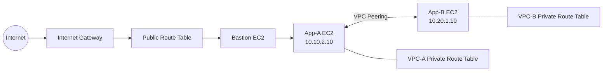

# AWS VPC Peering Architecture — Technical Documentation

## Project Overview

This project documents the design, implementation, and validation of an AWS Virtual Private Cloud (VPC) Peering architecture. The implementation demonstrates private communication between two isolated VPCs using EC2 instances, route tables, security groups, and a bastion host.

The documentation covers network architecture, CIDR allocation, subnet segmentation, routing configuration, secure administrative access, connectivity testing, troubleshooting, and security best practices.

## Project Objectives

- Design two VPCs with non-overlapping IPv4 CIDR ranges.
- Configure public and private subnets.
- Establish private communication through VPC Peering.
- Implement routing in both directions.
- Configure security groups to control network traffic.
- Access a private EC2 instance through a bastion host.
- Validate network connectivity using private IP addresses.
- Document the implementation process and technical findings.

## Technology Stack

- Amazon Virtual Private Cloud (VPC)
- Amazon EC2
- VPC Peering
- Route Tables
- Internet Gateway
- Security Groups
- Linux and SSH
- ICMP / Ping
- AWS Management Console

## Network Architecture



**Architecture summary:**

- VPC-A hosts the bastion host and App-A.
- VPC-B hosts App-B.
- VPC Peering enables private communication between the VPCs.
- Route tables direct traffic to the peering connection.
- Security groups control which traffic is permitted.
- The bastion host provides an SSH entry point to App-A.


## Network Configuration

| Resource | CIDR / Private IP | Purpose |
|---|---|---|
| VPC-A | `10.10.0.0/16` | Primary application network |
| VPC-A public subnet | `10.10.1.0/24` | Bastion host |
| VPC-A private subnet | `10.10.2.0/24` | App-A |
| VPC-B | `10.20.0.0/16` | Peer application network |
| VPC-B private subnet | `10.20.1.0/24` | App-B |
| Bastion EC2 | `10.10.1.10` | Secure SSH entry point |
| App-A EC2 | `10.10.2.10` | Private application instance |
| App-B EC2 | `10.20.1.10` | Peer application instance |

**Note:** Confirm the resource names and IP addresses against your AWS console before publication. The bastion's public IP may change unless an Elastic IP is assigned.

## Implementation Methodology 

### Step 1: Create VPC-A

**Configuration:** Create VPC-A with CIDR `10.10.0.0/16`.

**Reason:** A VPC provides an isolated virtual network in which AWS resources can communicate using private IP addresses. The selected CIDR defines the address space available to the network.

**Screenshot:**  


### Step 2: Create VPC-A Subnets

Create the following subnets:

- Public subnet: `10.10.1.0/24`
- Private subnet: `10.10.2.0/24`

**Reason:** Subnet segmentation separates the internet-facing administrative entry point from the private application workload. This supports a more controlled network design.

**Screenshot:**  


### Step 3: Configure the Internet Gateway

Create an Internet Gateway, attach it to VPC-A, and configure the public route table with:

`0.0.0.0/0 → Internet Gateway`

Associate the public route table with the public subnet and ensure the bastion has a public IPv4 address.

**Reason:** The Internet Gateway enables internet communication for appropriately routed public resources. A route alone is not sufficient; the instance also needs suitable addressing and security rules.

**Screenshot:**  


### Step 4: Create VPC-B

Create VPC-B with CIDR `10.20.0.0/16`.

**Reason:** The second VPC represents a separate network environment. Its CIDR does not overlap with VPC-A, allowing AWS routing to distinguish destinations unambiguously.

**Screenshot:**  


### Step 5: Create the VPC-B Private Subnet

Create a private subnet in VPC-B with CIDR `10.20.1.0/24`.

**Reason:** This subnet hosts App-B without requiring a public IP address for private communication with App-A.

**Screenshot:**  


### Step 6: Configure Route Tables and Subnet Associations

Create or verify the route tables for the public subnet in VPC-A, the private subnet in VPC-A, and the private subnet in VPC-B. Associate each subnet with its intended route table.

**Reason:** Route tables determine how traffic leaves a subnet. Correct subnet associations are essential because a route added to an unrelated route table will not affect the intended traffic.

**Screenshot:**  
FOR VPC A :


FOR VPC B: 


### Step 7: Configure Security Groups

Configure security groups using least-privilege access:

- Bastion: allow SSH (TCP 22) only from your trusted public IP.
- App-A: allow SSH from the bastion security group or its private address, according to the configuration.
- App-A and App-B: allow the required ICMP traffic for ping testing.

**Reason:** Security groups act as stateful virtual firewalls. Restricting inbound traffic reduces unnecessary exposure and helps protect application instances.

**Screenshot:**  


For app A:


For app B:


### Step 8: Create the EC2 Key Pair

Create or select the SSH key pair used for administrative access. The key used in this project was named `ewb-lab.pem`.

**Reason:** SSH key-based authentication allows secure access without relying on password-based login.

**Security requirement:** Never upload private key files, AWS access keys, passwords, or other credentials to GitHub.

### Step 9: Launch the EC2 Instances

Launch the instances in their intended subnets:

- Bastion in the VPC-A public subnet.
- App-A in the VPC-A private subnet.
- App-B in the VPC-B private subnet.

Verify the private IP addresses and security group associations.

**Reason:** These instances provide the endpoints required to demonstrate administrative access and private communication across the peering connection.

**Screenshot:**  


App A:


App B:


### Step 10: Connect to the Bastion Host

From Windows PowerShell, connect to the bastion using its current public IPv4 address:

```powershell
ssh -i "C:\Users\YOUR_WINDOWS_USER\Desktop\ewb-lab.pem" ec2-user@BASTION_PUBLIC_IP
```

Replace the placeholders with your actual Windows username and bastion public IP. Confirm the correct login username for the selected AMI.

**Reason:** The bastion provides a controlled SSH entry point for reaching a private instance without assigning that instance a public IP address.

**Screenshot:**  


### Step 11: Access App-A Through the Bastion

Use SSH ProxyCommand from Windows PowerShell:

```powershell
ssh -i "C:\Users\YOUR_WINDOWS_USER\Desktop\ewb-lab.pem" `
  -o IdentitiesOnly=yes `
  -o ProxyCommand="ssh -i C:\Users\YOUR_WINDOWS_USER\Desktop\ewb-lab.pem -o IdentitiesOnly=yes -W %h:%p ec2-user@BASTION_PUBLIC_IP" `
  ec2-user@10.10.2.10
```

Replace the Windows username and bastion public IP before executing the command.

**Reason:** ProxyCommand forwards the SSH connection through the bastion to App-A's private IP. This demonstrates access to a private instance through a controlled entry point.

**Screenshot:**  


### Step 12: Verify App-A's Private IP

Run the following command after logging in to App-A:

```bash
hostname -I
```

Verify that the output includes `10.10.2.10`.

**Reason:** This confirms that the SSH session reached the expected private instance and provides a baseline before connectivity testing.

**Screenshot:**  


### Step 13: Establish a Baseline Connectivity Test

From App-A, test the private IP of App-B:

```bash
ping -c 4 10.20.1.10
```

If peering routes are not yet configured, this test is expected to fail in the intended isolated network design.

**Reason:** A baseline test helps compare connectivity before and after peering configuration. Ping uses ICMP, so the result also depends on security group, network ACL, and host firewall rules.

### Step 14: Create and Accept the VPC Peering Connection

Create a VPC Peering connection between:

- VPC-A: `10.10.0.0/16`
- VPC-B: `10.20.0.0/16`

Accept the request and wait until the connection status is **Active**.

**Reason:** The peering connection establishes the relationship required for private routing between the two VPCs. It does not automatically create the necessary routes.

**Screenshot:**  


### Step 15: Configure Routes in Both VPCs

Add the following routes to the relevant private route tables:

| Route table | Destination | Target |
|---|---|---|
| VPC-A private route table | `10.20.0.0/16` | VPC Peering connection |
| VPC-B private route table | `10.10.0.0/16` | VPC Peering connection |

**Reason:** Both sides need routes to direct traffic destined for the other VPC through the peering connection. Missing a route in either direction can prevent communication.

**Screenshot — VPC-A route:**  


**Screenshot — VPC-B route:**  


### Step 16: Validate Private Connectivity

From App-A, execute:

```bash
ping -c 4 10.20.1.10
```

The App-A-to-App-B ping was successfully tested in this project.

If you also configured the necessary ICMP rules and performed a reverse-direction test, run this from App-B:

```bash
ping -c 4 10.10.2.10
```

**Reason:** Connectivity testing provides evidence that routing and traffic controls permit communication between the private instances. A successful ping validates ICMP reachability at the time of the test.

**Screenshot:**  


## Validation Summary

| Validation item | Result |
|---|---|
| VPC CIDR planning | Two non-overlapping CIDR ranges configured |
| Bastion SSH access | Successfully connected during the lab |
| App-A access through bastion | Successfully connected during the lab |
| App-A private IP verification | `10.10.2.10` |
| App-A to App-B ICMP test | Successful |
| VPC Peering routes | Configured in both directions |

## Troubleshooting

If private communication fails, verify:

1. The VPC Peering connection is active.
2. The VPC CIDR ranges do not overlap.
3. VPC-A has a route to `10.20.0.0/16` through peering.
4. VPC-B has a route to `10.10.0.0/16` through peering.
5. Each subnet is associated with the correct route table.
6. Security groups permit the required traffic.
7. Network ACLs and Linux host firewalls do not block the traffic.
8. The destination private IP address is correct.

## Security Considerations

- Restrict SSH access to trusted source IP addresses.
- Keep application instances private unless public access is explicitly required.
- Apply least-privilege security group rules.
- Never commit private keys, AWS credentials, or passwords.
- Review screenshots for sensitive account information before publishing.
- Remove unused AWS resources to reduce unnecessary costs.

## Conclusion

This project documents the implementation and validation of private communication between two AWS VPCs using VPC Peering. It demonstrates practical cloud networking concepts, controlled SSH access, routing configuration, security controls, and connectivity verification.

## Author

- **Name:** [SUMAN YADAV]
- **Project:** AWS VPC Peering Architecture
- **Documentation:** Technical implementation and validation for EWB PVT LTD.
---
